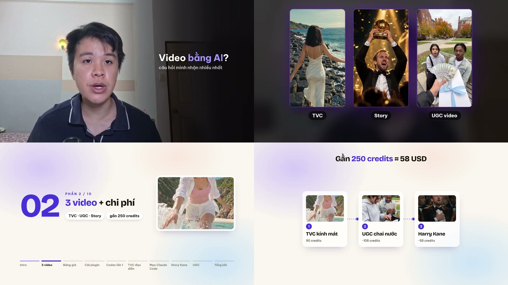
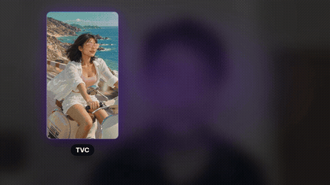
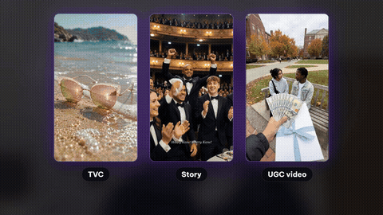
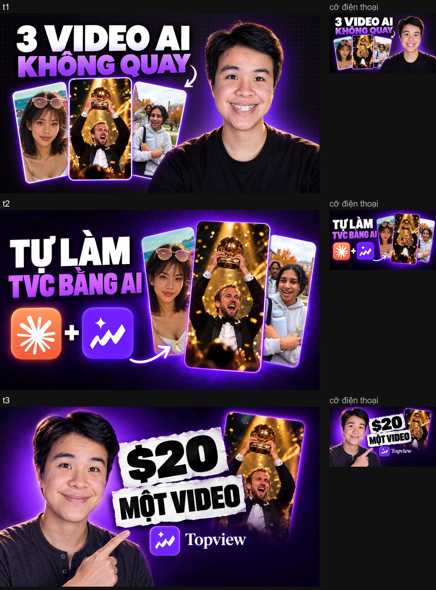
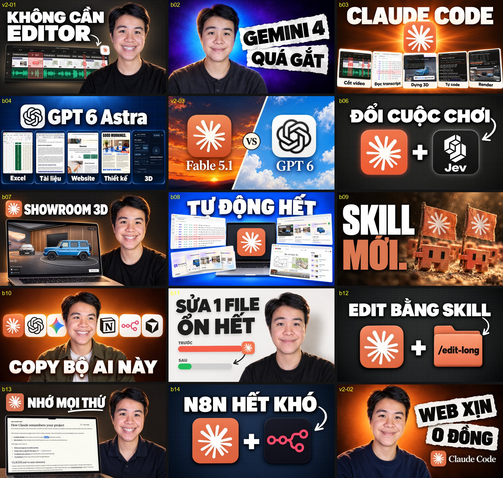

# youtube-ai-editor

Bộ 2 skill cho Claude Code (dùng được cả Codex): dán đường dẫn video quay thô, AI tự cắt vấp, chèn B-roll và motion graphics, tạo thumbnail có mặt thật, viết title và description, rồi up lên YouTube. Bạn chỉ duyệt 1 lần trước khi render.



Khung hình trên lấy từ video [Trải nghiệm làm video AI với Claude Code + Topview](https://youtu.be/6byH5JyDKc8): raw 28:40 ra bản đăng 19:57, toàn bộ edit bằng code chạy trên máy, không tốn API trả phí.

<p>
  
  
</p>

## Làm được gì

- **Cắt vấp.** Whisper chạy local, tách câu theo khoảng lặng thật, bỏ câu nói lại, câu bỏ dở, tiếng đệm, lệnh "cắt cắt" bạn nói lúc quay. Rút khoảng lặng theo nhịp editor thật và tăng tốc 1.1x. Có bảng `cut-report.md` liệt kê từng chỗ cắt.
- **Lệnh lúc quay.** Nói "Hey Claude, chèn ảnh chụp trang này vào đây" khi đang quay, skill cắt câu lệnh ra và làm đúng B-roll đó ở đúng chỗ.
- **Che thông tin.** Câu dặn editor kiểu "che lại thông báo tin nhắn này" được ghi lại thành vùng làm mờ.
- **B-roll và motion graphics** (skill `edit-long`): chapter card, chữ giữa dưới, slide dựng từ chất liệu thật (khung hình, file, giao diện app), template talking head kiểu Ben AI (khung trượt, chữ cạnh mặt, PiP, tường thumbnail). Đồ hoạ là HTML render bằng HyperFrames, ghép bằng ffmpeg.
- **Ảnh mẫu trước khi render.** Mỗi overlay có ảnh mẫu đặt lên đúng khung hình thật, gom vào 1 trang `review/index.html` để duyệt.
- **Thumbnail** kiểu Ben AI bằng Codex CLI (gói ChatGPT đang login, không cần API key): mặt thật, logo thật, UI thật, 3 mẫu để chọn.
- **Title, description, chapters** theo timestamp của bản cắt.
- **Up YouTube** ở chế độ private kèm thumbnail và description, sửa description sau khi up.



## Cần chuẩn bị gì

Bắt buộc:

- [Claude Code](https://claude.com/claude-code) hoặc [Codex](https://github.com/openai/codex).
- Python 3.10+ và ffmpeg/ffprobe trên PATH.
- Node 22+ (HyperFrames chạy qua `npx`, không cần cài trước).

Công cụ phụ:

| Dùng cho | Cần |
|---|---|
| Cắt vấp | `pip install faster-whisper numpy` (model whisper medium tự tải khoảng 1.5 GB lần đầu) |
| Ảnh mẫu, render | `pip install playwright pillow` rồi `playwright install chromium` |
| Encode nhanh | GPU NVIDIA (h264_nvenc). Không có GPU thì đổi sang libx264 trong `composite.py`, `build.py` |
| Chỉnh da (tuỳ chọn) | `pip install mediapipe opencv-python` + model `face_landmarker.task` |
| Thumbnail | Codex CLI login bằng ChatGPT gói trả phí (gói Free không có tool tạo ảnh). Mỗi ảnh tốn khoảng 25-45k token quota Codex |
| Up YouTube | `pip install google-api-python-client google-auth`, 1 OAuth client Google Cloud có YouTube Data API |

Đầu vào cho lần chạy đầu: 1 video quay thô (1 file hoặc nhiều phần), 2-3 ảnh mặt của bạn cho thumbnail (để trong `thumbnail/faces/` của project hoặc trỏ biến `THUMB_HEADSHOTS` tới thư mục ảnh).

## Cài đặt

Cách nhanh: dán prompt này vào Claude Code hoặc Codex.

```text
Cài 2 skill trong repo https://github.com/thanhthuduc99/youtube-ai-editor:
1. Clone repo về thư mục tạm.
2. Chép skills/youtube và skills/edit-long vào thư mục skill của mình (Claude Code: ~/.claude/skills/, Codex: ~/.codex/skills/).
3. Kiểm tra python, ffmpeg, node, rồi cài các package Python trong mục "Cần chuẩn bị gì" của README.
4. Chạy python template/scripts/setup_assets.py trong skill edit-long để tải font, GSAP, Three.js.
5. Báo lại mình còn thiếu gì.
```

Dùng Codex thì thêm câu "Đọc skills/youtube/SKILL.md và skills/edit-long/SKILL.md trước khi làm".

Cài tay:

```bash
git clone https://github.com/thanhthuduc99/youtube-ai-editor
cp -r youtube-ai-editor/skills/youtube youtube-ai-editor/skills/edit-long ~/.claude/skills/
```

Phần bạn tự làm: login Codex CLI bằng tài khoản ChatGPT, tạo OAuth client trên Google Cloud và lấy refresh token cho YouTube.

## Cách dùng

```text
/youtube D:/videos/raw/intro.mp4 D:/videos/raw/phan-1.mp4
```

Hoặc nói "edit video này lên youtube" kèm đường dẫn. Skill chạy liền 4 bước rồi dừng 1 lần:

1. Ghép các phần, chạy whisper, quyết định chỗ cắt, render `cut.mp4`.
2. Viết `edit-plan.json` (B-roll, chữ, chapter), dựng ảnh mẫu.
3. Tạo 3 thumbnail song song.
4. **Dừng chờ duyệt:** gửi bản cắt, trang ảnh mẫu, 3 thumbnail, 5-7 title và description.

Sau khi bạn nói "duyệt" và chọn thumbnail: render overlay, ghép final, QA (so khung với ảnh đã duyệt, đo lệch tiếng), lưu file, up YouTube private.

Up YouTube cần 3 biến `YOUTUBE_OAUTH_REFRESH_TOKEN`, `YOUTUBE_OAUTH_CLIENT_ID`, `YOUTUBE_OAUTH_CLIENT_SECRET` trong biến môi trường hoặc file `.env` (đổi đường dẫn file bằng `YOUTUBE_ENV`). Script không in key ra.

## Thumbnail đã làm bằng skill



## Cấu trúc

```
skills/
  youtube/      cắt vấp (template/cut), thumbnail (template/thumbnail), upload, quy trình 1 điểm dừng
  edit-long/    B-roll + motion graphics: builder overlay, ảnh mẫu, render, QA
```

## Ghi chú

- Ảnh tham khảo của kênh Ben AI và Liam Ottley (khung hình, thumbnail) không đưa lên repo vì thuộc kênh khác. Tải lại bằng `skills/edit-long/tools/ref_frames.py`, hoặc skill [thumbnail-reverse](https://github.com/thanhthuduc99/thumbnail-reverse) cho thumbnail.
- Hiệu ứng film burn không kèm theo vì không rõ quyền phát lại. Muốn dùng thì tải pack free rồi đặt vào `edit-long/template/assets/transitions/`.
- File ví dụ trong `references/` dùng đường dẫn mẫu `C:/work/youtube/...`, thay bằng đường dẫn của bạn.
- Luật trong `SKILL.md` ghi theo gu edit của tác giả (chữ giữa dưới, không zoom, chất liệu thật). Sửa trong `references/style.md` cho hợp kênh của bạn.

## License

MIT
